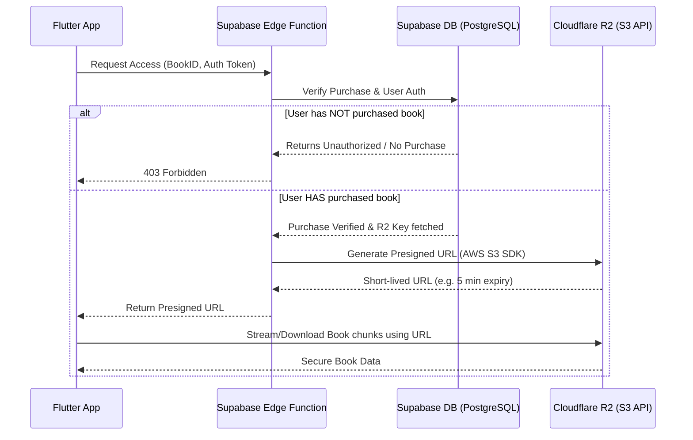

# Supabase Edge Function to Cloudflare R2 Presigned URLs

## Overview

In `digital_poth_gula`, e-books must be protected from unauthorized downloads while allowing legitimate purchasers to read them. This is achieved by storing the encrypted or original book files in **Cloudflare R2** and serving them to the client via **short-lived presigned URLs** generated by a **Supabase Edge Function**.

## Architecture Flow

## Implementation Steps

### 1. Cloudflare R2 Configuration
- Create an R2 bucket (e.g., `digital-poth-gula-books`).
- Generate S3 API credentials (Access Key ID and Secret Access Key).
- Do **not** make the bucket public.

### 2. Supabase Edge Function
Create an Edge Function (e.g., `generate-book-url`) using Deno. 

**Dependencies:**
- `https://esm.sh/@supabase/supabase-js@2`
- `https://deno.land/x/s3_lite_client@0.7.0/mod.ts` (or standard AWS SDK for JS v3)

**Environment Variables in Supabase:**
- `R2_ACCESS_KEY_ID`
- `R2_SECRET_ACCESS_KEY`
- `R2_ENDPOINT` (e.g., `https://<account_id>.r2.cloudflarestorage.com`)
- `R2_BUCKET_NAME`

**Function Logic:**
1. **Authenticate User**: Read the `Authorization` header to verify the JWT and identify the `user_id`.
2. **Verify Purchase**: Query the `purchases` table for `user_id` and requested `book_id`.
3. **Fetch File Key**: Query the `books` table to get the `r2_full_file_key`.
4. **Generate Presigned URL**: Use the S3 client to generate a `GetObject` presigned URL with a very short expiration time (e.g., 5-10 minutes) for the `r2_full_file_key`.
5. **Return URL**: Send the URL back to the Flutter app.

### 3. Flutter App (Frontend)
- The app uses `flutter_windowmanager` to prevent screen capturing while the reader is active.
- It calls the Edge Function with the user's JWT.
- It uses `syncfusion_flutter_pdfviewer` (or similar depending on format) to load the PDF directly from the received short-lived URL.
- By not saving the file to local storage, and with the URL expiring quickly, we enforce strict DRM constraints.
